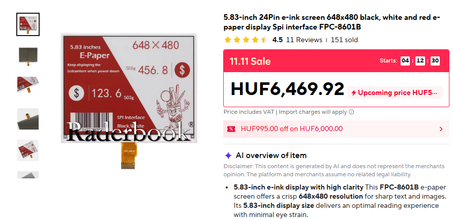
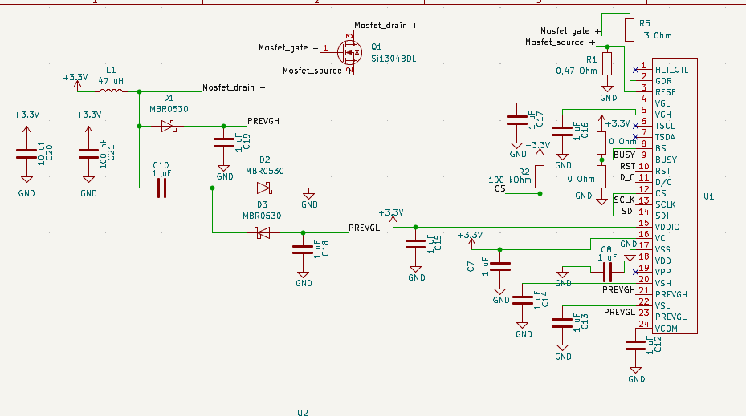
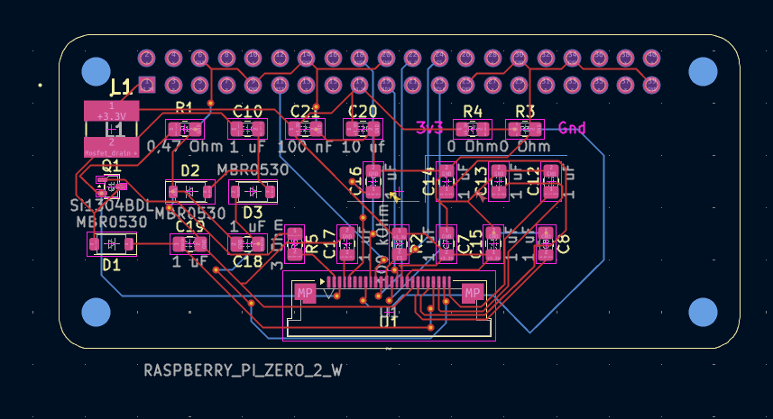
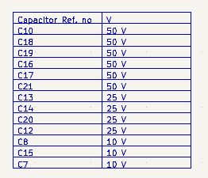
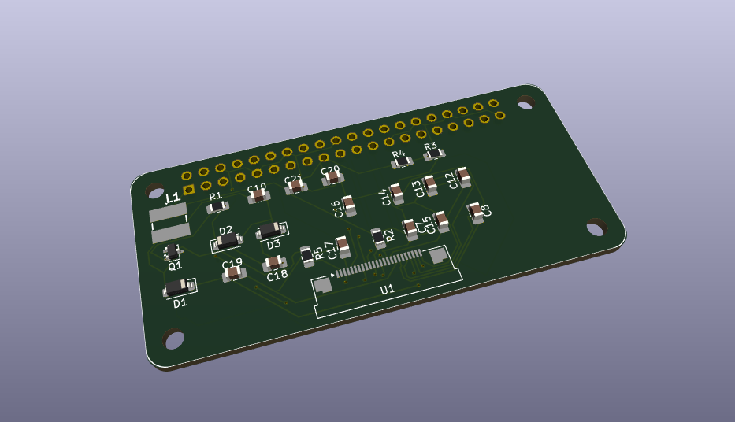

# Mornigong_display
Welcome all to my project mornigong, and this part of it: Mornigong display.
This project uses a cheap aliexpress eink raw screen (Image below), a raspberry pi zero 2 w, and a custom made driver board for the screen.

## The board I made

This is the schematic of my board. The connector is an FPC 24 pin cable, carrying SPI data, and power for the screen. As the screen has no power onboard, I had to make the power boost circuit too. It is largely based on the official Waveshare esp32 driver board V3.(Source: https://files.waveshare.com/wiki/E-Paper-ESP32-Driver-Board/E-Paper_ESP32_Driver_Board_V3.pdf?)

This is the final PCB layout, and routing. Everything is close to the components it needs to be. (Or I hope so...)

This is a help table for the resistor voltages with the reference numbers.


This is the 3d render of the board. It is designed to be a hat for the zero 2 w.

## Software
The software I used, is as open-source project, called Inkypi, made by Faith Ak. (https://github.com/fatihak/InkyPi)
### Installation guide
- Write an image of an official Raspberry pi OS lite 64bit on your sdcard/usb drive.
- Clone the repository: ```git clone https://github.com/fatihak/InkyPi.git```
- Navigate to the project directory: ```cd InkyPi```
- Run the installation script with sudo: ```sudo bash install/install.sh -W epd7in5b_HD``` (as the screen I am using is an exact copy of the Waveshare 7.5 in model.)

### Example software
There is a copy of an example software in this repo, called "ex_software.bin" which is an image of the directory of Inkypi on my RPI with my screen model.

# Important
- This project is not tested yet, it only works in theory.
- All the credits go to Faith ak, for the Inkypi software.
